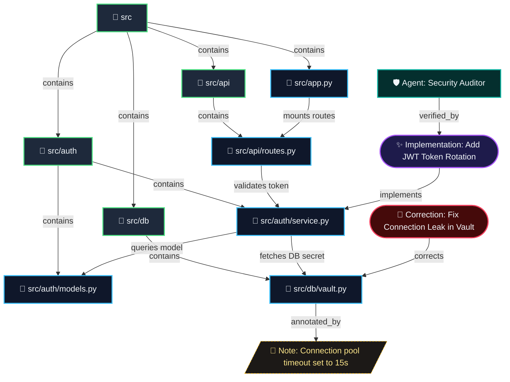

# GGI — Graph-based General Intelligence Memory

**Build, query, and share rich context graphs of your codebase so that any AI agent or human can understand what exists, what was built, what was fixed, and how everything connects.**

[](LICENSE)
[](https://python.org)

---

## Why GGI?

Modern codebases are complex. When you hand a project to a new developer — or a new AI agent — they face the same problem: *understanding what's here and what happened.*

GGI solves this by creating a **memory graph**: a directed graph where every file, module, change, correction, and annotation is a node, and every relationship (imports, implements, corrects, depends-on) is an edge. The graph is:

- **Scannable** — point it at a directory and it auto-maps the structure
- **Annotatable** — record what was implemented, what was corrected, and why
- **Queryable** — ask "what's the context for this file?" and get a rich bundle ready for agent hand-off
- **Exportable** — JSON, YAML, interactive HTML, Mermaid diagrams, Graphviz DOT
- **Shareable** — give the graph to another system/agent and they immediately have context

---

## Installation

```bash
pip install ggi
```

For interactive HTML visualisation:

```bash
pip install ggi[viz]
```

For development (from source):

```bash
git clone https://github.com/shudhanshu/ggi.git
cd ggi
pip install -e ".[dev,viz]"
```

---

## Quick Start

### CLI Usage

```bash
# Scan a directory → produces memory_graph.json
ggi scan ./my-project

# Scan with options
ggi scan ./my-project -o graph.json --name "My App" --depth 5

# View graph stats
ggi show graph.json

# Query nodes
ggi show graph.json --kind file --search "utils"

# Show directory tree from graph
ggi tree graph.json

# Get rich context for a specific node (agent hand-off ready)
ggi context graph.json <node-id>
ggi context graph.json <node-id> --json-out

# Launch interactive Web UI + Question Panel in browser
ggi ui graph.json

# Ask questions using Graph Intelligence directly from terminal
ggi ask graph.json "What was implemented in this project?"
ggi ask graph.json "What bugs or errors were corrected?"
ggi ask graph.json "How does frontend connect to backend?"

# Use with a local SLM (e.g. Ollama llama3.2, phi3)
ggi ask graph.json "Explain the architecture" --slm-url http://localhost:11434

# Export as self-contained interactive web app with Q&A panel
ggi export graph.json --interactive -o interactive_viewer.html

# Export as Pyvis network HTML
ggi export graph.json --html -o viz.html

# Export as Mermaid diagram
ggi export graph.json --mermaid

# Export as Graphviz DOT
ggi export graph.json --dot -o graph.dot
```

### Python API

```python
from ggi import MemoryGraph, FileNode, ChangeRecord, ContextEdge, EdgeKind

# Create a graph
g = MemoryGraph(project="my-app", description="Main application")

# Add files
main = g.add_file(FileNode(
    path="src/main.py",
    language="python",
    summary="Application entry point",
    context="Initialises the Flask app, registers blueprints, starts the server.",
))

utils = g.add_file(FileNode(
    path="src/utils.py",
    language="python",
    summary="Shared utility functions",
    context="Contains date parsing, string sanitisation, and logging helpers.",
))

# Add relationships
g.add_edge(ContextEdge(
    source=main.id,
    target=utils.id,
    kind=EdgeKind.IMPORTS,
    label="main imports utils",
))

# Record what was implemented
g.record_change(ChangeRecord(
    title="Add user authentication",
    description="Implemented JWT-based auth with refresh tokens",
    change_type="implementation",
    targets=[main.id],
    author="alice",
))

# Record what was corrected
g.record_change(ChangeRecord(
    title="Fix timezone bug in date parser",
    description="UTC offset was being dropped when parsing ISO 8601 dates",
    change_type="correction",
    targets=[utils.id],
    author="bob",
))

# Add free-form annotations
g.annotate(utils.id, "Consider splitting this into date_utils and string_utils")

# Get context for hand-off to another agent
context = g.context_for(main.id)
# Returns: node details, all changes, annotations, neighbours, incoming/outgoing edges
```

### Auto-scanning a codebase

```python
from ggi import scan_directory, save_graph

# Scan a directory tree
graph = scan_directory(
    "./my-project",
    project_name="My Project",
    max_depth=10,
    include_content_hash=True,
)

# Save to JSON (or YAML)
save_graph(graph, "memory_graph.json")
save_graph(graph, "memory_graph.yaml", fmt="yaml")
```

---

## Graph Structure

### Live Example Memory Graph

GitHub natively renders the diagram below. It illustrates a complete codebase memory graph representing a cloud application with directories, source files, cross-file imports/calls, implementation records, bug fix records, annotations, and security agents:



> **Try this example locally:** Run `ggi ui examples/sample_memory_graph.json` to launch the interactive 2D fluid & 3D galaxy explorer on this graph!

### Node Kinds

| Kind | Description |
|------|-------------|
| `file` | A source file |
| `directory` | A directory in the tree |
| `module` | A logical grouping (package, namespace) |
| `function` | A function or method |
| `class` | A class definition |
| `concept` | An abstract domain concept |
| `change` | A recorded implementation, correction, or refactor |
| `agent` | An AI agent or human contributor |
| `annotation` | A free-form note attached to any node |

### Edge Kinds

| Kind | Description |
|------|-------------|
| `contains` | Parent → child (directory → file, file → class) |
| `imports` | File A imports / depends on file B |
| `calls` | Function A calls function B |
| `implements` | A change that added new functionality |
| `corrects` | A change that fixed a bug or issue |
| `depends_on` | Generic dependency relationship |
| `related_to` | Soft conceptual link |
| `annotated_by` | A node's annotation |
| `authored_by` | Who made a change |

---

## Agent Hand-off: `context_for()`

The killer feature for AI agents. Call `graph.context_for(node_id)` and get a complete context bundle:

```python
context = graph.context_for("src/main.py")
```

Returns:

```json
{
  "node": {
    "id": "abc123",
    "path": "src/main.py",
    "kind": "file",
    "language": "python",
    "summary": "Application entry point",
    "context": "Initialises the Flask app..."
  },
  "changes": [
    {
      "title": "Add user authentication",
      "change_type": "implementation",
      "description": "Implemented JWT-based auth..."
    }
  ],
  "annotations": [
    { "text": "Consider adding rate limiting" }
  ],
  "incoming": [...],
  "outgoing": [...],
  "neighbours": {
    "center": "abc123",
    "nodes": [...],
    "edges": [...]
  }
}
```

Hand this JSON to any agent and it instantly knows:
- What the file is and what it does
- What was built there and what was fixed
- What notes/concerns exist
- What it connects to

---

## Interactive Graph Explorer & Question Panel

GGI includes a dedicated interactive web interface featuring:
- **Interactive Force-directed Graph Canvas**: Drag, zoom, pan, physics toggle, kind filters (Files, Directories, Changes, Annotations, Agents).
- **Node Details Inspector**: Click on any node to view its summary, language, full code content preview, connected implementation records, and dependencies.
- **Embedded Question & Answer (Q&A) Panel**: Ask natural language questions about what was built, what was fixed, or how services communicate.
- **Bi-directional Canvas Linking**: Clicking cited node pills in an answer automatically highlights and centers the camera on those nodes in the graph!
- **Pluggable SLM / Local LLM**: Out-of-the-box zero-dependency Graph Reasoning Engine, with optional pass-through to local SLMs like Ollama (`llama3.2`, `phi3`, etc.).

### Launch the Live UI Server

```bash
ggi ui graph.json
# Or specify a port and optional SLM:
ggi ui graph.json --port 8501 --slm-url http://localhost:11434
```

### Export as a Standalone Single-File Web App

Generate an offline-capable HTML file with the full graph and built-in client-side reasoning engine:

```bash
ggi export graph.json --interactive -o interactive_viewer.html
open interactive_viewer.html
```

---

## Question Answering (GraphQA API & CLI)

You can query the memory graph directly from the terminal or in Python:

### CLI Question Answering

```bash
# Ask about implementations
ggi ask graph.json "What was implemented in this project?"

# Ask about bug fixes and corrections
ggi ask graph.json "What bugs or errors were corrected?"

# Ask about architecture / data flow
ggi ask graph.json "How does React frontend talk to Django backend?"
```

### Python API Question Answering

```python
from ggi import load_graph, GraphQA

graph = load_graph("memory_graph.json")
qa = GraphQA(graph)

response = qa.ask("What was implemented and what was corrected?")
print(response["answer"])
print("Cited Nodes:", response["cited_nodes"])
```

---

## Visualisation

### Interactive HTML (pyvis)

```bash
ggi export graph.json --html -o viz.html
open viz.html
```

Produces a fully interactive, zoomable graph with colour-coded nodes, tooltips, and physics simulation.

### Mermaid Diagram

```bash
ggi export graph.json --mermaid
```

Outputs a Mermaid flowchart you can paste into GitHub READMEs, Notion, or any Mermaid renderer.

### Graphviz DOT

```bash
ggi export graph.json --dot -o graph.dot
dot -Tpng graph.dot -o graph.png
```

---

## Traversal & Querying

```python
# Find all Python files
python_files = graph.find_nodes(kind=NodeKind.FILE, language="python")

# Find files matching a path pattern
utils = graph.find_nodes(path_contains="utils")

# Get neighbourhood (ego graph) of a node
neighbours = graph.neighbours(node_id, depth=2)

# Find shortest path between two nodes
path = graph.path_between(source_id, target_id)

# Get weakly connected components
components = graph.connected_components()

# Get graph statistics
stats = graph.stats()
# → { project, total_nodes, total_edges, node_kinds, edge_kinds, components }
```

---

## Serialisation Formats

### JSON (default)

```bash
ggi scan . -o graph.json
```

Compact, universal, easy to pipe into other tools.

### YAML

```bash
ggi scan . -o graph.yaml --format yaml
```

Human-readable, great for checking into version control.

Both formats are fully round-trippable — load a JSON graph, save as YAML, load again.

---

## Project Structure

```
ggi/
├── __init__.py          # Public API exports
├── models.py            # FileNode, ChangeRecord, ContextEdge, enums
├── graph.py             # MemoryGraph — the core data structure
├── scanner.py           # Auto-scan directories into a graph
├── serializer.py        # JSON / YAML save & load
├── visualizer.py        # HTML, Mermaid, DOT export
└── cli.py               # Click-based CLI (ggi command)
tests/
└── test_core.py         # Comprehensive test suite
pyproject.toml           # Build config (hatchling)
README.md
LICENSE                  # MIT
```

---

## Comparison with Graphify

| Feature | GGI | Graphify |
|---------|-----|----------|
| Graph model | Directed, typed nodes & edges | Varies |
| Change tracking | First-class (implements/corrects) | ✗ |
| Agent context hand-off | Built-in `context_for()` | ✗ |
| Annotations | Built-in | ✗ |
| Auto-scanning | Yes, with language detection | Varies |
| Export formats | JSON, YAML, HTML, Mermaid, DOT | Varies |
| Installable CLI | `pip install ggi` | Varies |
| Extensible node/edge types | Enum-based, easy to extend | Varies |

GGI is inspired by graph-based knowledge tools but purpose-built for **codebase memory** and **agent hand-off**.

---

## Contributing

```bash
git clone https://github.com/shudhanshu/ggi.git
cd ggi
pip install -e ".[dev,viz]"
pytest
```

---

## License

[MIT](LICENSE) — Shudhanshu Pandey
